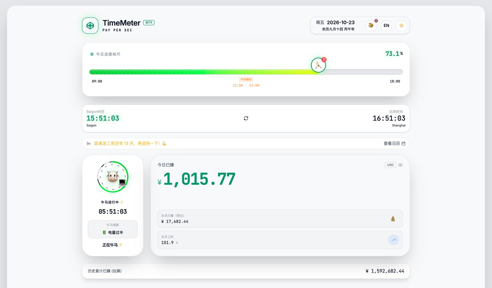
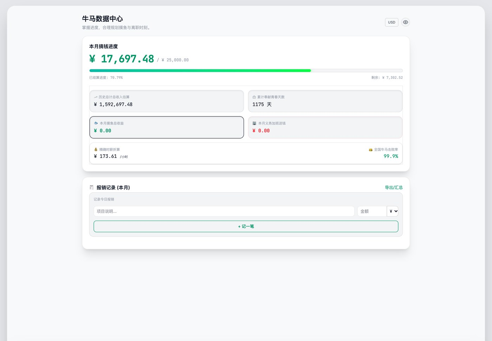

<div align="center">

# TimeMeter · 牛马时钟

**Your salary, ticking per second — live earnings, clock-off and payday countdowns, a slacking ledger, a focus timer and a visa calendar.**

[](https://barry-tawny.vercel.app/) [](https://react.dev/) [](https://www.typescriptlang.org/) [](https://vite.dev/) [](#data-and-privacy)

[简体中文](README.md) · **English**

<a href="https://barry-tawny.vercel.app/"></a>

<sub>Home · sample data (25,000 CNY/month, 09:00–18:00, payday on the 5th, joined in 2021)</sub>

</div>

---

## Overview

Enter your monthly salary, working hours and payday, and TimeMeter turns your workday into a number that keeps moving: what you have earned today, an estimate for the month, your total since your first day, and how many milk teas or litres of petrol that buys.

It also covers the rest of office life: countdowns to clock-off, the weekend, payday and retirement; slacking and unpaid-overtime timers that convert seconds into "earned for free" or "given away"; a leave panel; an immersive pomodoro; a work calendar with public holidays and lunar dates; and visa and travel-day tracking for Vietnam and Thailand.

No account, no backend, no analytics. Everything stays in browser localStorage.

> 牛马 (*niúmǎ*, "beast of burden") is Chinese internet slang for an overworked employee. The tone is deliberately self-deprecating; the tool is genuinely useful.

## Features

### Live earnings

| Capability | What it does |
|---|---|
| **Pay per second** | Monthly salary ÷ working days this month ÷ daily hours; the meter stops outside working hours and pauses over lunch |
| **Several totals** | Today, this week, this month, this year and since your first day; unpaid leave is deducted from the month |
| **Progress ruler** | Where you are in the workday, including the lunch break |
| **Purchasing power** | Milk tea, coffee, petrol, iPhones or a custom item |
| **Dual currency and privacy** | CNY / USD toggle; one tap masks every amount as `****` |
| **Share card** | A saveable earnings card rendered with html2canvas |

### Countdowns and ledger

- Five countdowns: clock-off, next rest day, payday, anniversaries and retirement.
- **Slacking timer**: each second becomes money "earned for free". **Unpaid overtime timer**: each second becomes money "given away".
- Leave panel: paid and unpaid leave, with deductions reflected in the totals.
- An excuse generator for slacking: random local phrases, no model involved.
- Data centre: monthly earnings progress, exact hourly rate, slacking and overtime totals, a playful "percentage of workers you beat", and multi-currency expense records with export.

### Focus

- An immersive pomodoro with 10 animated vessels: incense (25 min), candle, hourglass, coffee, instant noodles, cigarette, ice, cherry blossom, moon and campfire.
- White noise, pink noise and scene ambience are synthesised live with Web Audio — no audio files.
- Separate sounds for start, finish and break, plus system notifications.

### Calendar and visas

- Work calendar with public holidays and make-up workdays for mainland China, Hong Kong, Vietnam and Thailand, alongside lunar dates.
- Leave and memos can be added directly on a day.
- Visa page: record visa type, validity and entry/exit history; it computes the current stay, days spent this year and a remaining-days severity level.
- Port lists cover the main airports and land crossings in Vietnam and Thailand.

### Also

- Chinese and English UI (541 strings), light and dark themes.
- Multiple saved "niuma profiles" for comparing salary and schedule scenarios.
- Responsive on desktop and mobile.

<a href="https://barry-tawny.vercel.app/"></a>

<sub>Data centre · monthly progress, exact hourly rate, slacking / overtime ledger and expenses</sub>

## Stack and implementation

| Layer | Choice |
|---|---|
| Framework | React 19 + TypeScript + Vite 6 |
| Styling | Tailwind CSS 4 + custom design tokens |
| Motion | Motion (`motion/react`) |
| Icons | lucide-react |
| Dates | lunar-javascript (lunar calendar) + built-in holiday tables |
| Audio | Web Audio API, live noise and alert synthesis |
| Export | html2canvas |
| State | React state + localStorage, no global store |

The clock is driven by a Web Worker that posts a tick every second rather than relying on `setInterval`; when a background tab is throttled, the app catches up as soon as it returns to the foreground.

## Quick start

```bash
npm install
npm run dev     # http://localhost:3000
npm run build
npm run lint    # tsc --noEmit
```

`GEMINI_API_KEY` in `.env.example` is only used by `scripts/translate/` for translating UI strings. Running the app needs no key.

## Project layout

```text
.
├── src/
│   ├── App.tsx            Main app: home / focus / calendar / data / settings
│   ├── VisaTab.tsx        Visas and travel records
│   ├── holidays.ts        Holidays for CN / HK / VN / TH
│   ├── i18n.ts            Chinese / English switch
│   ├── dict-zh.json       Chinese strings (541)
│   ├── dict-en.json       English strings
│   ├── index.css          Tailwind and design tokens
│   └── lib/NoiseSynth.ts  Web Audio noise synthesis
├── scripts/translate/     String translation (Google / Gemini, dev only)
├── scripts/verify/        Repro / accessibility / performance / i18n check scripts
├── docs/OPTIMIZATION-GUIDE.md  Optimization & roadmap guide (task list, fixes, tricks; written in Chinese)
└── metadata.json          AI Studio metadata
```

> Contributing, human or agent: start with [`docs/OPTIMIZATION-GUIDE.md`](docs/OPTIMIZATION-GUIDE.md) (Chinese, with an English TL;DR at the top).

## Data and privacy

- All settings and records live in localStorage: `niuma_config`, `niuma_runtime_state`, `niuma_profiles`, `my_visas`, `my_travel_records` and others.
- No backend, no account, no analytics; the running app makes no network requests.
- Changing browser, clearing storage or using private mode loses the data. Use the share card or a screenshot if it matters.

## Limitations

- Earnings are a **gross estimate**: monthly salary spread over the month's working days, excluding tax, social insurance, housing fund, bonuses and overtime pay.
- Unpaid leave deducts one full day (salary ÷ working days this month); half days and cross-month cases are not modelled.
- Holiday tables run through 2027; update `src/holidays.ts` after that.
- The visa page covers only Vietnam and Thailand and counts days of stay. It is not visa or legal advice.
- Slacking excuses are random local phrases. Being caught by your boss is not covered.
- There is no automated test suite; run `npm run lint` after changes.

## Acknowledgements

- Initial scaffold generated with Google AI Studio
- [lunar-javascript](https://github.com/6tail/lunar-javascript) for the lunar calendar
- [lucide-react](https://lucide.dev/), [Motion](https://motion.dev/), [Tailwind CSS](https://tailwindcss.com/)
- Holiday data compiled from public government schedules

## License

No open-source license is declared. Contact the author before reusing code or assets.
