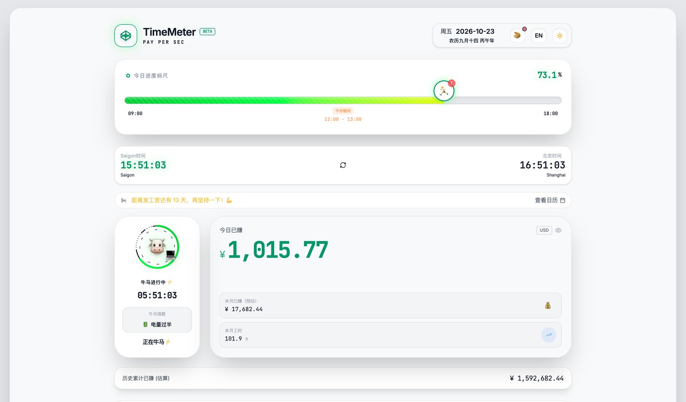
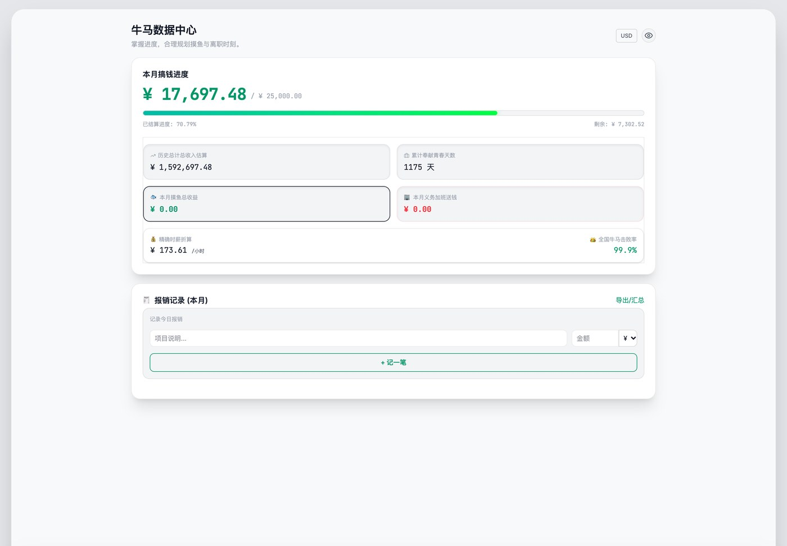

<div align="center">

# 牛马时钟 · TimeMeter

**把工资拆成每秒：实时收入、下班与发薪倒计时、摸鱼账本、番茄钟和签证日历。**

[](https://barry-tawny.vercel.app/) [](https://react.dev/) [](https://www.typescriptlang.org/) [](https://vite.dev/) [](#数据与隐私)

**简体中文** · [English](README.en.md)

<a href="https://barry-tawny.vercel.app/"></a>

<sub>首页 · 示例数据（月薪 25,000、09:00–18:00、5 号发薪、2021 年入职）</sub>

</div>

---

## 简介

输入月薪、作息和发薪日，TimeMeter 会把工作时间换算成一条持续跳动的数字：今天赚了多少、本月预估多少、入职以来累计多少，以及这些钱能换几杯奶茶、几升汽油。

它还顺手把打工人的其余需求做成了工具：下班 / 休息日 / 发薪 / 退休倒计时，摸鱼与义务加班计时（按秒折算成「白赚」或「损失」），请假操作板，沉浸番茄钟，带节假日与农历的工作日历，以及越南 / 泰国的签证与停留天数记录。

没有账号、没有后端、没有埋点。所有数据只写进浏览器 localStorage。

## 功能

### 实时收入

| 能力 | 说明 |
|---|---|
| **按秒计薪** | 月薪 ÷ 当月工作日 ÷ 每日工时得到每秒收入；非工作时间自动停表，午休不计 |
| **多口径累计** | 今日、本周、本月、本年、入职以来；本月会扣掉无薪假 |
| **今日进度标尺** | 一天的工作进度、午休区间与当前时间位置 |
| **购买力换算** | 奶茶、咖啡、汽油、iPhone 与自定义商品 |
| **双币与隐私** | CNY / USD 切换，一键把金额变成 `****` |
| **分享图** | html2canvas 生成一张可保存的收益卡 |

### 倒计时与账本

- 下班、休息日、发薪日、纪念日、退休五类倒计时。
- **摸鱼计时**：每秒折算成「白赚」；**义务加班计时**：每秒折算成「损失」。
- 请假操作板：带薪假 / 无薪假，扣款会反映到累计收入。
- 一键生成摸鱼话术：本地语料随机抽取，不调用任何模型。
- 数据中心：本月搞钱进度、精确时薪、摸鱼 / 加班总额、趣味「全国牛马击败率」、多币种报销记录与导出。

### 专注

- 沉浸番茄钟，10 种容器动画：线香（25 分钟）、蜡烛、沙漏、咖啡、泡面、香烟、冰块、樱花、月亮、篝火。
- 白噪音 / 粉红噪音与场景音由 Web Audio 实时合成，不加载音频文件。
- 开始 / 结束 / 休息三种提示音可分别设置，支持系统通知。

### 日历与签证

- 工作日历：中国、香港、越南、泰国的法定节假日与调休，附农历日期。
- 日历里可以直接记请假与备忘。
- 签证页：登记签证类型、生效 / 到期日与出入境记录，计算本次停留、年度停留天数与剩余天数分级。
- 口岸列表覆盖越南、泰国的主要机场与陆路口岸。

### 其它

- 中 / 英双语（541 条文案），明暗两套主题。
- 多份「牛马配置」可保存切换，对比不同工资 / 工时方案。
- 桌面与移动端自适应。

<a href="https://barry-tawny.vercel.app/"></a>

<sub>数据中心 · 本月搞钱进度、精确时薪、摸鱼 / 加班账本与报销记录</sub>

## 技术栈与实现

| 层 | 选型 |
|---|---|
| 框架 | React 19 + TypeScript + Vite 6 |
| 样式 | Tailwind CSS 4 + 自定义设计 token |
| 动效 | Motion（`motion/react`） |
| 图标 | lucide-react |
| 日期 | lunar-javascript（农历）+ 内置节假日表 |
| 音频 | Web Audio API 实时合成噪音与提示音 |
| 导出 | html2canvas |
| 状态 | React state + localStorage，无全局状态库 |

计时由 Web Worker 每秒发 tick，而不是只靠 `setInterval`；后台标签页被节流时，回到前台会立即补算。

## 快速开始

```bash
npm install
npm run dev     # http://localhost:3000
npm run build
npm run lint    # tsc --noEmit
```

`.env.example` 里的 `GEMINI_API_KEY` 只用于 `scripts/translate/` 的文案翻译，运行应用不需要任何 Key。

## 项目结构

```text
.
├── src/
│   ├── App.tsx            主应用：首页 / 专注 / 日历 / 数据 / 设定
│   ├── VisaTab.tsx        签证与停留记录
│   ├── holidays.ts        中国 / 香港 / 越南 / 泰国节假日
│   ├── i18n.ts            中英切换
│   ├── dict-zh.json       中文文案（541 条）
│   ├── dict-en.json       英文文案
│   ├── index.css          Tailwind 与设计 token
│   └── lib/NoiseSynth.ts  Web Audio 噪音合成
├── scripts/translate/     文案翻译（Google / Gemini，开发用）
├── scripts/verify/        复现脚本：BUG 复现 / 无障碍扫描 / 性能探针 / 翻译覆盖
├── docs/OPTIMIZATION-GUIDE.md  优化与演进指南（任务清单、修复方案、技巧库）
└── metadata.json          AI Studio 元信息
```

> 想改进这个项目（人或 Agent）：先读 [`docs/OPTIMIZATION-GUIDE.md`](docs/OPTIMIZATION-GUIDE.md)。

## 数据与隐私

- 所有配置与记录都在 localStorage：`niuma_config`、`niuma_runtime_state`、`niuma_profiles`、`my_visas`、`my_travel_records` 等。
- 没有后端、没有账号、没有埋点，应用运行时不发任何网络请求。
- 换浏览器、清缓存或用无痕模式会丢失记录；重要数据请用分享图或截图留存。

## 已知限制

- 收入是**税前粗算**：按自然月工作日和固定月薪折算，不含个税、社保、公积金、奖金与加班费。
- 无薪假按「月薪 ÷ 当月工作日」扣一天，未考虑跨月或半天假。
- 节假日表内置到 2027 年，之后需要更新 `src/holidays.ts`。
- 签证页只覆盖越南、泰国，计算方式为停留天数统计，不构成签证或法律建议。
- 摸鱼话术是本地随机语料，被老板识破概不负责。
- 没有自动化测试；改动后跑 `npm run lint` 做类型检查。

## 致谢

- 初始脚手架来自 Google AI Studio
- [lunar-javascript](https://github.com/6tail/lunar-javascript)（农历）
- [lucide-react](https://lucide.dev/)、[Motion](https://motion.dev/)、[Tailwind CSS](https://tailwindcss.com/)
- 节假日数据整理自各地公开的放假安排

## License

未声明开源许可证。如需复用代码或素材，请先联系作者。
